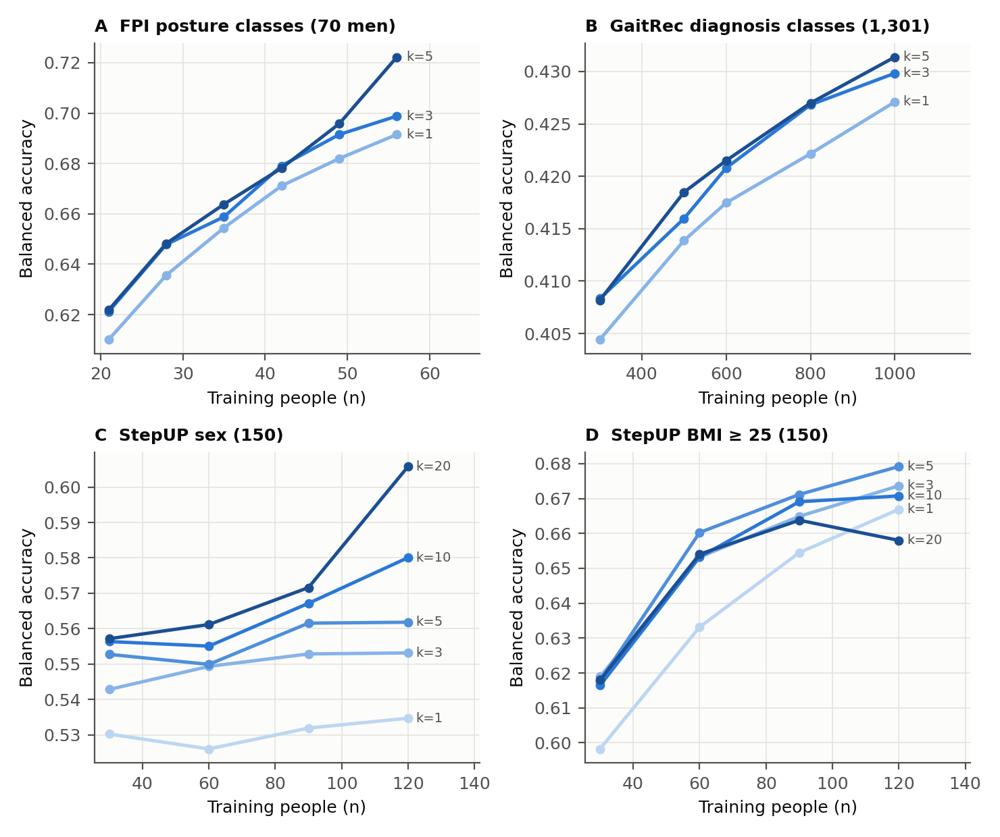
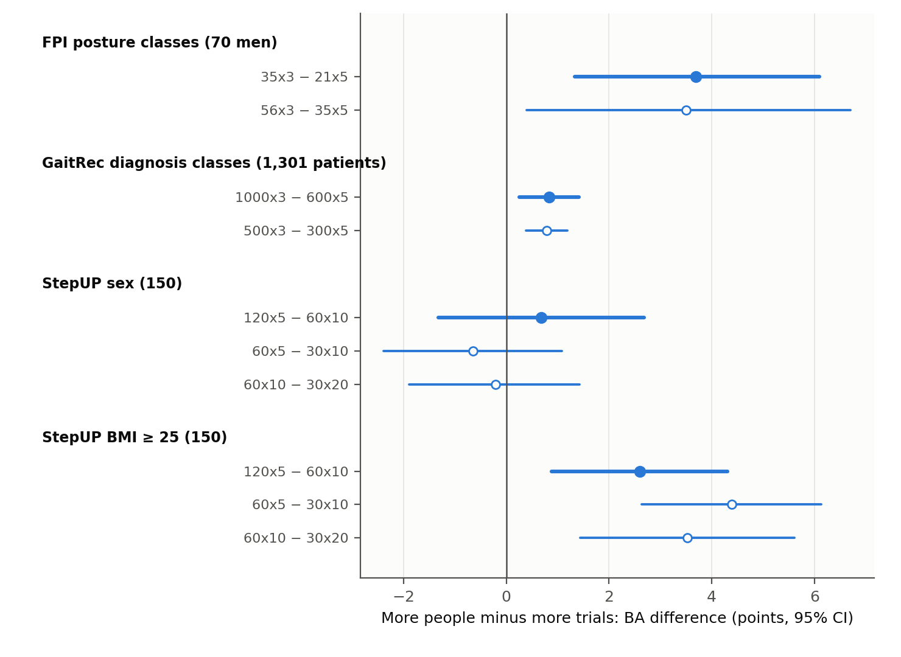
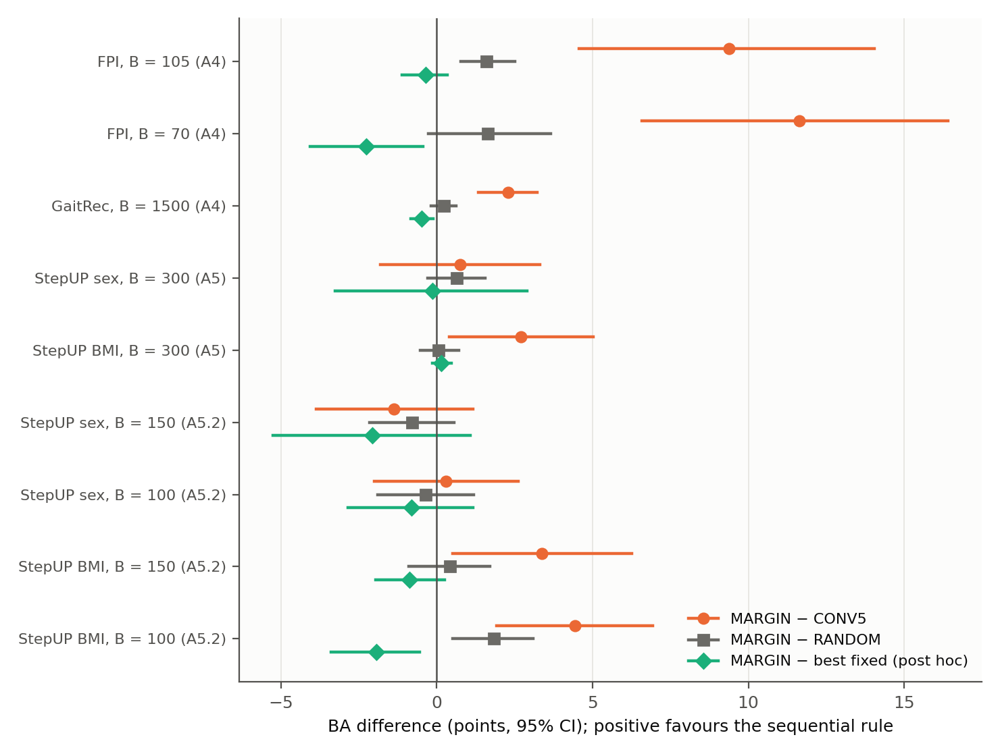

# Participants or repeated trials? Equal-budget learning surfaces and an evaluated sequential acquisition rule in three gait datasets

[Authors, affiliations and corresponding author: to be completed by the authors]

## Abstract

Studies that train gait classifiers must decide how to spend a fixed number of recordings: recruit more people, or repeat trials in the people already recruited. We measured this trade-off in three public datasets of separately recorded gait trials: static foot-posture classes from kinematic, pressure and anthropometric inputs in 70 men; five diagnosis classes from vertical ground-reaction force in 1,301 patients; and sex and body-mass-index category from plantar pressure in 150 adults with up to 20 footsteps each. Classifiers were trained on nested subsets that contained only the selected people and trials, and were tested on unseen people. With the number of recordings held equal, more people and fewer trials gave higher balanced accuracy for foot posture (+3.7 points, 95% CI 1.3 to 6.1), for diagnosis (+0.8, 0.3 to 1.4) and for the BMI category (+2.6, 0.9 to 4.3), but not for sex (+0.7, −1.3 to 2.7), where additional footsteps kept helping up to 20. Raising the number of trials per person from three to five rarely helped. A sequential rule that chooses between recruiting and repeating from the data acquired so far improved on the five-trial convention in six of nine budget settings that the recruitable pool did not saturate, but not on the best fixed design. Protocols, amendments and verification records are reported.

**Keywords:** gait analysis; learning curve; study design; sample size; plantar pressure; ground reaction force

## 1. Introduction

Machine-learning classification of gait has grown quickly: deep learning is now used for both classification and regression in quantified gait analysis [1], and classical models are used to separate foot conditions and gait patterns in clinical cohorts [2,3]. These models are trained on recordings from people, and each person usually walks several times. Repeating a trial costs far less than recruiting another person, and protocols commonly record about five trials per person. Trials from the same person are strongly correlated, however, and most classifiers are meant to work for people who were not in the training set. Evaluation that lets a person's recordings appear in both training and test data inflates performance [4–6], and models that rank well on one dataset need not transfer equally well to new patients [7]. Reporting guidance for prediction models asks authors to justify their sample size [8], and sample-size methods for prediction models are expressed in numbers of participants [9]. If the number of people rather than the number of recordings governs generalisation, repeated trials may add little. How a fixed recording budget should be split between people and repeats is therefore a design question with a measurable answer.

Existing work addresses neighbouring questions. Reliability studies ask how many strides or trials give a stable measurement within a person [10,11]. Studies of trial aggregation ask how to combine the trials of a person at assessment [12]. Individual-level analyses show that gait values and responses to conditions such as fatigue differ considerably between people [13]. For group comparisons in biomechanics, Forrester showed that the better use of effort depends on whether between-person or within-person variability dominates [14]; a similar trade-off between trials and subjects has been described for group-level effects in neuroimaging [15]. Learning-curve studies describe how classifier accuracy grows with the number of training subjects [16,17], and large EEG studies continue to gain from more data [18]. In EEG, Seibel and colleagues varied both the number of training subjects and the number of EEG segments per subject for convolutional networks [19]. Adding subjects helped more than adding segments, gains from segments levelled off after about four, and an eyes-open versus eyes-closed task benefited more from segments than the other tasks. They recommended incremental data collection with periodic evaluation but did not implement or test a collection policy.

In searches of OpenAlex, Crossref and the web in October 2026, including the works citing Seibel and colleagues (one, outside gait research), we found no study of gait, plantar-pressure or ground-reaction-force classification that varied the number of training people and the number of separately recorded trials per person jointly, tested on unseen people, and compared designs with equal numbers of recordings. These searches were targeted and are not a systematic review (Supplementary S12). In gait, a trial is a separate walk or footstep, whereas an EEG segment is usually a window cut from one continuous recording, so results from EEG cannot be assumed to carry over.

We therefore asked four questions in three gait datasets. First, how does balanced accuracy for unseen people vary over the number of training people and trials per person (a learning surface)? Second, when the number of recordings is equal, is a design with more people and fewer trials better than one with fewer people and more trials? Third, do these answers depend on the one tuned hyperparameter of the classifier? Fourth, can a sequential rule that decides between recruiting and repeating from the data acquired so far improve on the five-trial convention and on fixed designs? We do not propose a new classifier, and we make no claim of clinical utility.

## 2. Methods

### 2.1 Design and pre-specification

All analyses are secondary analyses of public, de-identified datasets. The work was run as a sequence of stages. Before each stage was executed, a written protocol (the grid of designs, comparators, endpoints, fit accounting and verification checks) and the analysis script were hashed with SHA-256; the hashes are listed in Supplementary Table S2. Mechanical problems that appeared during execution, for example an acquired training set that lacked a class, were handled by dated amendments written before any performance result of that stage was read. Every failed or stopped attempt was kept (Supplementary S1). The protocols were not registered with an external registry. Because all three cohorts had been analysed earlier in this project (classification and reliability analyses of the foot-posture and GaitRec development data, and a different question about temporal pressure shares for 42 of the 150 StepUP participants), every result here is exploratory and none is a confirmatory test on untouched data.

### 2.2 Datasets and tasks

{{TABLE:table1_datasets}}

*Foot posture (FPI).* Sanchis-Sales and colleagues released right-foot joint angles, joint moments and plantar-pressure tensors from 70 healthy men (350 stance recordings, five per person), grouped by static Foot Posture Index into neutral (30), highly supinated (20) and highly pronated (20) feet [20]. Each trial was summarised by 28 descriptors computed from that trial only: the mean and range of nine joint-rotation signals (ankle, midtarsal and first metatarsophalangeal joints in three planes) and ten statistics of the 40 × 40 × 100 pressure tensor and the peak-pressure scalar. Nineteen person-level anthropometric inputs were added (13 numeric fields and one-hot toe shape for both feet). Foot Posture Index scores, joint moments and subject-centred features were never used as inputs: the first define the label, and the last require several trials of the same person at assessment.

*GaitRec.* GaitRec provides processed vertical ground-reaction-force curves, normalised to body weight and stance duration (101 samples per side), for healthy controls and patients with hip, knee, ankle or calcaneus impairments [21]. We used the official training partition, self-selected speed, normal shoes and no orthopaedic insoles. For each person we took the first chronological session with at least five valid left–right trial pairs and the five lowest trial identifiers, giving 1,301 people (healthy 146, hip 234, knee 368, ankle 350, calcaneus 203). Each trial is a vector of 202 values. The official test partition was never used.

*StepUP-P150.* StepUP-P150 contains high-resolution plantar-pressure footsteps from 150 adults walking at preferred speed barefoot or in socks (condition BF/W1) [22]. We used the released preprocessed footsteps of pipeline 2, right-foot steps that were not flagged as outlier, excluded, standing or incomplete, ordered by footstep identifier, and the first 20 per person (every person had at least 31). Each step was reduced to 200 mean-pressure values (10 time bins × 5 × 4 spatial blocks) computed from that step alone. Two between-person labels from the participant metadata were specified before any result was computed: sex (76 female, 74 male) and body-mass index of at least 25 kg/m² (74 of 150). They serve only as generic between-person targets with many trials per person and carry no clinical meaning here.

### 2.3 Restricted acquisition

For a design with n training people and k trials per person, the n people and, for each of them, the k trials were drawn before anything was computed. Unselected trials played no part in any step, including standardisation, dimension reduction and classifier fitting. We enforced this and tested it: for every final model, and for the refits of the FPI sensitivity analysis, a control model was fitted with the unselected entries replaced by large random noise, and its coefficients and test probabilities had to be identical bit for bit to those of the real model. All 38,700 control fits passed.

Designs were nested within each draw: the people of a smaller design were a class-stratified subset of the people of a larger one, and the trials of a smaller k were a subset of the trials of a larger k, for the same person. Class allocation used largest remainders on the class counts of the fold's training people, so that every acquired set contained all classes. Test people were the recorded held-out people of each fold and always contributed all of their trials (five for FPI and GaitRec, 20 for StepUP), summarised by the median, so that the test input was identical across designs and differences between designs reflect training alone.

### 2.4 Classification pipelines

The person-level input was the median over the retained trials of each trial descriptor (a median of features, not of predicted probabilities). For FPI, the 28 medians and the 19 anthropometric inputs were standardised and passed to balanced multinomial logistic regression with L2 penalty (C = 0.1). For GaitRec and StepUP, the median trial vector was standardised, reduced to 12 principal components, standardised again and passed to the same classifier. All learned transformations were fitted on the acquired people only. The value C = 0.1 was fixed in advance because it was selected in 14 of 15 outer folds for FPI and 15 of 15 for GaitRec in earlier nested tuning on the same cohorts; a sensitivity analysis with C tuned inside every acquired set is reported (Section 3.5).

### 2.5 Learning surfaces and equal-budget contrasts

Each cohort was evaluated with three repeats of person-disjoint five-fold cross-validation (FPI: 56 training and 14 test people per fold; GaitRec: about 1,040 and 260; StepUP: 120 and 30). In every fold we drew 20 acquisition samples (random people and trials) for each cell of the grid. The grid was n in {21, 28, 35, 42, 49, 56} and k in {1, 3, 5} for FPI; n in {300, 500, 600, 800, 1000} and k in {1, 3, 5} for GaitRec; and n in {30, 60, 90, 120} and k in {1, 3, 5, 10, 20} for StepUP. The endpoint was person-level balanced accuracy (mean recall over classes) with log loss as a secondary endpoint. For each repeat and draw, predictions for all people were pooled over the five folds, so that each person contributed one prediction, and the cell value is the mean over the 3 × 20 = 60 repeat–draw values.

The primary contrast of each dataset compared two designs with the same number of recordings (n × k) and was fixed before the results were seen: 35 × 3 against 21 × 5 (105 recordings) for FPI; 1000 × 3 against 600 × 5 (3,000) for GaitRec, with 500 × 3 against 300 × 5 (1,500) as secondary; and 120 × 5 against 60 × 10 (600) for StepUP, with 60 × 5 against 30 × 10 (300) and 60 × 10 against 30 × 20 (600) as secondary. One FPI contrast, 56 × 3 against 35 × 5, differs by seven recordings (168 against 175) and is labelled as such. Both designs of a contrast shared the same draw, the same test people and nested people and trials. Finite differences between neighbouring cells along n (same k) and along k (same n) describe the surface; no functional form was fitted and nothing was extrapolated beyond the grid.

### 2.6 Uncertainty

The unit of inference is the person. We drew 5,000 class-stratified bootstrap resamples of the unique person identifiers (70, 1,301 or 150 people) and gave each person one multiplicity weight that was applied to every fold, repeat, draw and design. Weighted balanced accuracy and log loss were computed for each resample, and paired differences were computed on the same weights; the 2.5th and 97.5th percentiles give the 95% intervals. Repeated prediction rows of a person are never treated as independent observations. The intervals are conditional on the fitted models, the recorded splits and the cohorts. They do not include re-fitting uncertainty or the variability expected in independent cohorts, and because the three repeats reuse the same people the 60 paired values of a contrast are not 60 independent observations. We report the standard deviation over draws within a repeat and the standard deviation of the three repeat means separately, because the pooled standard deviation mixes the two. No adjustment for multiple comparisons was made; contrasts are labelled primary or secondary.

### 2.7 Sequential acquisition rule and comparators

The recruitable pool of a fold is its training people, each with all available trials (five, five or 20). A recording is one real trial of one real person. The budget B is the total number of recordings. The sequential rule (MARGIN) starts with W people and two trials each. It then spends the budget in batches of b recordings. At every decision it estimates, from the acquired data only, the gain per recording of more people and of more trials. It does so by three-fold person-level cross-validation inside the acquired set, repeated for three random fold assignments, comparing the balanced accuracy of (i) the full acquired set, (ii) a set from which a random 20% of the training people were removed and (iii) a set in which one random trial was removed from every person with at least two trials. The loss in balanced accuracy divided by the number of recordings removed is the estimated gain per recording. One of the three replicates is chosen at random; if its people gain is at least its trial gain the next batch recruits new people (one trial each), otherwise it adds one trial to each of the b recruited people with the fewest trials. If an estimate is undefined, which occurs when the acquired set is too small, the rule recruits. Recruitment order is random and blind to class. No setting of the rule was tuned.

Comparators used the same recruitment and trial orders in each fold and seed (common random numbers): the five-trial convention (CONV5, five trials for each recruited person); fixed designs with one to four trials per person (FIX1 to FIX4), and ten and 20 in StepUP; and a rule that spends each batch on people or on trials by a fair coin after the same warm start (RANDOM). When a fixed design exhausts the pool before the budget is spent, the remaining budget is spent on additional trials of recruited people. The best fixed design at each budget was chosen after the fact and is shown for reference only. A model fitted on an acquired set that lacks a class assigns probability zero to it, and a single-class set yields the constant predictor of that class; these rules matter only for very small designs.

Budgets were FPI 105 (primary) and 70, with W = 7, b = 7 and 20 seeds; GaitRec 3,000 (primary) and 1,500, with W = 100, b = 100 and five seeds; and StepUP 600 (primary) and 300, with W = 10, b = 20 and 10 seeds. In GaitRec and StepUP the primary budget was saturated by the pool (the best designs recruit everyone), so the secondary budget carries the information. Because the first StepUP budgets were large relative to the 120-person pool, a follow-up with budgets 150 and 100 and batches of 10 was added after those results had been seen; it is a declared exploratory follow-up.

### 2.8 Sensitivity to regularisation

For the two cells of each primary FPI contrast and the StepUP sex contrast, we repeated the analysis with C chosen inside every acquired set from {0.1, 1, 10} by three-fold person-level cross-validation on log loss (ties to the smaller C), with the scaler and, for StepUP, the principal components fitted on the inner-training people only. The acquired sets and draws were those of the main analysis.

### 2.9 Verification

For every stage a separate script that refitted nothing re-checked the saved results: protocol, script and input hashes; membership of every acquired set (distinct real people and trials, no test person, nesting, class counts); exclusion of unselected trials by rebuilding every scaler from the retained trials alone; replay of every saved model on the saved test inputs; recomputation of all metrics, contrasts and intervals; convergence; and fit counts. A pass certifies only these listed checks. Code ran in Python 3.11.15 with scikit-learn 1.7.2 [23] and NumPy 2.3.4 on a CPU.

## 3. Results

### 3.1 Learning surfaces

**Figure 1.** Learning surfaces. Mean person-level balanced accuracy (60 values per cell: three repeats × 20 acquisition draws) against the number of training people, one line per number of trials per person (k; darker is more). A, foot-posture classes (70 men; chance 0.33). B, GaitRec diagnosis classes (1,301 patients; chance 0.20). C, StepUP sex (150; chance 0.50). D, StepUP BMI ≥ 25 (150; chance 0.50). The cell with the largest n and largest k uses the whole training set and therefore has a single composition. Intervals are in Supplementary Tables S3 to S6.

Balanced accuracy rose with the number of training people in FPI, GaitRec and StepUP BMI, and rose little at fixed k in StepUP sex (Figure 1). It ranged from 0.610 (21 people, one trial) to 0.722 (56 people, five trials) for FPI, from 0.404 (300 × 1) to 0.431 (1000 × 5) for GaitRec, from 0.530 (30 × 1) to 0.606 (120 × 20) for StepUP sex, and from 0.598 (30 × 1) to 0.679 (120 × 5) for StepUP BMI. Across the four tasks, 53 of 57 steps that added people had a positive point estimate and 31 had a 95% interval above zero; no step had an interval below zero (Table 2). Steps that added trials were less consistent: 45 of 54 were positive, 14 had an interval above zero and none had an interval below zero.

{{TABLE:table2_finite_differences}}

Going from three to five trials per person added little. In 18 of the 19 cells the point estimate of the gain was between −0.1 and +1.0 points, and in 17 the interval included zero (Supplementary Table S7). The exceptions were FPI at 56 people (+2.3 points, 95% CI 0.2 to 4.9; this cell is the whole training set) and GaitRec at 500 people (+0.3, 0.1 to 0.4).

### 3.2 Designs with equal numbers of recordings

**Figure 2.** Equal-recording comparisons. Balanced-accuracy difference between a design with more people and fewer trials and a design with fewer people and more trials that uses the same number of recordings. Filled markers, primary contrast; open markers, secondary contrasts (the FPI 56 × 3 − 35 × 5 contrast differs by seven recordings). Bars, 95% participant-level bootstrap intervals conditional on the fitted models.

{{TABLE:table3_equal_budget}}

Three of the four primary contrasts favoured more people (Table 3, Figure 2). For FPI, 35 people with three trials exceeded 21 people with five trials by 3.7 points (95% CI 1.3 to 6.1; 45 of 60 paired comparisons). For GaitRec the difference between 1000 × 3 and 600 × 5 was 0.8 points (0.3 to 1.4), and between 500 × 3 and 300 × 5 it was 0.8 (0.4 to 1.2). For StepUP BMI, 120 × 5 exceeded 60 × 10 by 2.6 points (0.9 to 4.3), and both secondary contrasts agreed (+4.4 and +3.5). For StepUP sex the balanced-accuracy differences were indeterminate (+0.7, −1.3 to 2.7; −0.6, −2.4 to 1.1; −0.2, −1.9 to 1.4). Log loss favoured more people in every primary contrast, with intervals that excluded zero (FPI −0.087, GaitRec −0.016, StepUP sex −0.036, StepUP BMI −0.057). The FPI contrast with an unequal budget (168 against 175 recordings) gave +3.5 points (0.4 to 6.7).

### 3.3 Two regimes within one dataset

StepUP showed both patterns (Figure 1C and 1D). For BMI, accuracy at 120 people was highest at five trials and did not increase with more footsteps (10 to 20 trials: −1.3 points, 95% CI −3.4 to 0.7). For sex, accuracy kept increasing with footsteps up to 20: at 120 people, going from five to ten trials added 1.8 points (0.3 to 3.3) and from ten to 20 added 2.6 points (0.0 to 5.2). Sex also benefited little from more people at fixed k: only one of 15 steps that added people had an interval above zero. The 120 × 20 cell is the whole training set, so its interval reflects the sampling of people only. We interpret the two tasks as lying in different regimes, one in which the information is limited by the number of people and one in which it is limited by noise within a person, in line with the view that the better allocation depends on which source of variability dominates [14]; we did not estimate variance components for these tasks.

### 3.4 Variability across acquisition draws and repeats

{{TABLE:table4_variability}}

Differences between acquisition draws were large relative to the contrasts themselves, but the direction was stable across repeats (Table 4). For the FPI primary contrast the standard deviation over draws within a repeat was 5.2 points, whereas the standard deviation of the three repeat means was 0.55 points; the design with more people was better in 14, 15 and 16 of the 20 draws in the three repeats. The within-repeat standard deviation of a cell fell with the number of people, from 4.7 points at 21 × 3 to zero at 56 × 5, which has a single composition.

### 3.5 Sensitivity to regularisation

{{TABLE:table5_sensitivity}}

Choosing C inside each acquired set did not change the conclusions (Table 5). The FPI primary contrast was +4.0 points (1.6 to 6.2) with tuned C and +3.7 (1.3 to 6.0) with C = 0.1; the latter differs in the last digit from Table 3 because the bootstrap resamples of the two analyses differ. Tuning selected C = 0.1 in 83% of the 35 × 3 sets and 79% of the 21 × 5 sets, and in 99% to 100% of the StepUP sex sets. Within a cell, tuning changed balanced accuracy by at most 0.3 points and made log loss worse by 0.036 (35 × 3) and 0.043 (21 × 5); we therefore report that the quality of the predicted probabilities was lower with tuning, without a statement about calibration, which we did not measure.

### 3.6 Sequential acquisition rule

**Figure 3.** The sequential rule (MARGIN) compared with the five-trial convention, a random allocation rule and the best fixed design chosen after the fact. Budgets saturated by the recruitable pool (GaitRec 3,000; StepUP 600) are omitted. Positive values favour MARGIN; bars are 95% participant-level bootstrap intervals.

{{TABLE:table6_policy_ba}}

{{TABLE:table7_policy_contrasts}}

The rule improved on the five-trial convention in six of the nine budget settings that the pool did not saturate (Tables 6 and 7, Figure 3). Gains were +9.4 points (95% CI 4.6 to 14.0) for FPI at 105 recordings and +11.6 (6.6 to 16.4) at 70, +2.3 (1.3 to 3.2) for GaitRec at 1,500, and +2.7 (0.4 to 5.0), +3.4 (0.5 to 6.3) and +4.4 (1.9 to 6.9) for StepUP BMI at 300, 150 and 100. For StepUP sex all three differences included zero (+0.8, −1.4 and +0.3 points). At the saturated GaitRec budget of 3,000 the rule recruited the whole pool and gained 1.0 point (0.3 to 1.8) over the convention, which uses only 600 people; at the saturated StepUP budget of 600 all designs coincided.

The rule did not improve on the best fixed design. Its difference from the best fixed design chosen after the fact ranged from −2.3 to +0.1 points and was never significantly positive; the interval excluded zero on the negative side for FPI at 70 recordings (−2.3 points, −4.1 to −0.4), GaitRec at 1,500 (−0.5, −0.8 to −0.1) and StepUP BMI at 100 (−1.9, −3.4 to −0.5). In the tasks where people dominated, the best fixed design was one trial per person for every budget except the saturated GaitRec budget. The rule spent {{SHARE_PEOPLE}} of its batches on new people and, across the budgets that the pool did not saturate, ended with 44 to 890 people at 1.6 to 2.5 trials each. It was better than the random rule only for FPI at 105 recordings (+1.6, 0.8 to 2.5) and StepUP BMI at 100 (+1.8, 0.5 to 3.1). In the trial-relevant StepUP sex task, the best fixed design at 150 recordings was ten trials per person (balanced accuracy 0.556), but the rule did not find it: it recruited 85 people with about 1.8 trials and was 2.1 points below the best fixed design (−5.3 to 1.1) and 1.4 points below the convention (−3.9 to 1.2). Its internal estimate was undefined, and the rule defaulted to recruiting, in {{UNDEFINED_TEXT}}.

## 4. Discussion

### 4.1 Principal findings

With a fixed number of recordings, spreading them over more people gave higher balanced accuracy for unseen people than repeating trials in fewer people in three of four tasks, and the same direction held for log loss in all four. The advantage was 3.7 points for foot posture, 2.6 points for BMI and 0.8 points for gait-disorder diagnosis, and it was indeterminate for sex, where more footsteps per person kept helping. Beyond about three trials, additional trials seldom improved accuracy, with exceptions in the low-signal sex task. A sequential rule that learns the allocation from the acquired data improved on the five-trial convention where people dominated but did not beat a simple fixed design such as one or two trials per person, and it did not find the trial-heavy design in the one task where that design was best.

### 4.2 Relation to earlier work

The pattern agrees with the EEG results of Seibel and colleagues, who found that adding subjects helped more than adding segments, that segments saturated after a few, and that one task benefited more from segments [19]. It also agrees with the argument that the better allocation depends on the relative size of between-person and within-person variability [14,15], and with individual-level gait analyses that find large differences between people [13]. Our data add that the same holds when the repeats are separately recorded walks or footsteps, that the answer can differ between labels on the same recordings (sex against BMI in StepUP), and that the effect in the diagnosis task is small in absolute terms. Seibel and colleagues noted that tasks in which the informative pattern is rare, such as seizure detection, may profit more from longer recordings [18,19], and they recommended incremental data collection with periodic evaluation [19]; our evaluation of a concrete rule shows that a simple backward-difference estimate recovers the convention's disadvantage but not the best fixed rule, and that the estimate appears unreliable at small budgets. Selective repeated acquisition has been studied for noisy labels [24]; here the repeated quantity is the measurement of an input, which has a different noise structure.

### 4.3 Practical implications

For a study whose aim is to train a classifier that works for new people, and when a recording budget is the constraint, these results support recruiting people first, adding trials only when recruiting becomes impractical, and expecting little from more than about three trials per person, unless a pilot learning surface shows a trial-relevant regime. A small pilot with a few designs on the same recording grid, as used here, can show which regime applies. In the tasks where people dominated, a fixed design with one trial per person (with extra trials only after the pool was exhausted) was at least as good as the adaptive rule, so adaptivity is not needed to avoid the five-trial penalty. These statements concern classification accuracy for unseen people; repeated trials may still be justified by measurement reliability, within-person analyses or quality control, which we did not study.

### 4.4 Limitations

First, the three cohorts are small or specialised and were explored repeatedly; the FPI cohort has 70 healthy men with selected extreme posture classes, the StepUP test folds have 30 people, and the intervals are conditional on the fitted models and recorded splits and exclude uncertainty from independent cohorts. Second, the classifier is a regularised linear model on a median person vector with one fixed hyperparameter; other models, including deep networks, may have different surfaces. Third, a recording is a count, not a cost: recruitment, travel, consent and processing time differ between people and repeated trials, so equal recordings are not equal costs, and we did not model time or money. Fourth, all trials of a person come from one session, so between-day variability, which would favour repeated sessions, is not represented. Fifth, the tasks differ in difficulty: five-class balanced accuracy for GaitRec is 0.43 (chance 0.20), and sex and BMI are not clinical targets. Sixth, pools are small relative to some budgets; in GaitRec at 3,000 and StepUP at 600 recordings the pool was saturated and the policies coincided, and an adaptive rule might behave differently with much larger pools. Seventh, the sequential rule used one simple estimator with no tuning, and its failure in the trial-relevant task may be due to that estimator rather than to the idea. Eighth, the StepUP small-budget stage was added after results had been seen, and contrasts were not adjusted for multiplicity. Ninth, the three cross-validation repeats reuse the same people, so the paired values of a contrast are not independent observations, and the intervals do not reflect re-fitting uncertainty.

### 4.5 Conclusions

In three gait datasets with separately recorded trials, equal recording budgets bought more balanced accuracy for unseen people when spent on more people than on repeated trials, except in one low-signal label where repeated footsteps kept helping. More than about three trials per person rarely paid off. An adaptive allocation rule beat the five-trial convention but not a simple fixed rule. For gait classifier studies the practical recommendation is to recruit first, repeat modestly, and check the regime with a small pilot.

## Data and code availability

The datasets are public: the foot-posture data (doi:10.1038/s41597-024-04166-3), GaitRec (doi:10.1038/s41597-020-0481-z) and StepUP-P150 (doi:10.20383/103.01285; descriptor doi:10.1038/s41597-025-05792-1). Protocols, analysis and verification scripts, derived result tables, verification records and the amendment history are available at https://github.com/mohammadsedighimanesh/gait-acquisition-design. The raw datasets are not redistributed; the repository describes how to obtain them and rebuild every input.

## Ethics

This is a secondary analysis of public, de-identified datasets; ethics approval and consent are described in the original descriptors [20–22].

## Funding, competing interests and author contributions

[To be completed by the authors.]

## References

1. Khan A, Galarraga C OA, Garcia-Salicetti S, Vigneron V. Deep learning for quantified gait analysis: a systematic literature review. IEEE Access 2024;12:138932–138957. doi:10.1109/ACCESS.2024.3434513
2. Özateş ME, Yaman A, Salami F, Campos S, Wolf SI, Schneider U. Identification and interpretation of gait analysis features and foot conditions by explainable AI. Sci Rep 2024;14:5998. doi:10.1038/s41598-024-56656-4
3. Vandekerckhove I, Papageorgiou E, Hanssen B, et al. Gait classification for growing children with Duchenne muscular dystrophy. Sci Rep 2024;14:10828. doi:10.1038/s41598-024-61231-y
4. Kapoor S, Narayanan A. Leakage and the reproducibility crisis in machine-learning-based science. Patterns 2023;4(9):100804. doi:10.1016/j.patter.2023.100804
5. Brookshire G, Kasper J, Blauch NM, Wu YC, Glatt RM, Merrill DA, et al. Data leakage in deep learning studies of translational EEG. Front Neurosci 2024;18:1373515. doi:10.3389/fnins.2024.1373515
6. Pe S, Dagliati A, Parimbelli E, Guerra BMV, Sozzi S, Bellazzi R, et al. How improper dataset split hinders model generalizability: a systematic comparison in human activity recognition and exercise evaluation tasks. Int J Med Inform 2026;216:106464. doi:10.1016/j.ijmedinf.2026.106464
7. Salomon A, Gazit E, Shimoni N, et al. Beyond the leaderboard: evaluating the robustness of deep learning models for detecting freezing of gait. Eur J Neurosci 2026;63(3):e70424. doi:10.1111/ejn.70424
8. Collins GS, Moons KGM, Dhiman P, Riley RD, Beam AL, Van Calster B, et al. TRIPOD+AI statement: updated guidance for reporting clinical prediction models that use regression or machine learning methods. BMJ 2024;385:e078378. doi:10.1136/bmj-2023-078378
9. Riley RD, Snell KIE, Archer L, Ensor J, Debray TPA, Van Calster B, et al. Evaluation of clinical prediction models (part 3): calculating the sample size required for an external validation study. BMJ 2024;384:e074821. doi:10.1136/bmj-2023-074821
10. Commandeur D, Klimstra M, Yoshida K, Hundza S. The minimum number of strides required for reliable gait measurements in older adult fallers and non-fallers. Sensors 2024;24(23):7666. doi:10.3390/s24237666
11. Carvalho A, Vanrenterghem J, Pataky TC, Robinson MA, Veloso A, Moniz-Pereira V. How many strides are needed for reliable markerless gait analysis? Gait Posture 2025;123:110020. doi:10.1016/j.gaitpost.2025.110020
12. Slijepcevic D, Zeppelzauer M, Schwab C, Raberger A-M, Breiteneder CJ, Horsak B. Input representations and classification strategies for automated human gait analysis. Gait Posture 2020;76:198–203. doi:10.1016/j.gaitpost.2019.10.021
13. Zhou LJ, Schneider J, Arnrich B, Konigorski S. Analyzing population-level trials as N-of-1 trials: an application to gait. Contemp Clin Trials Commun 2024;38:101282. doi:10.1016/j.conctc.2024.101282
14. Forrester SE. Selecting the number of trials in experimental biomechanics studies. Int Biomech 2015;2(1):62–72. doi:10.1080/23335432.2015.1049296
15. Chen G, Pine DS, Brotman MA, Smith AR, Cox RW, Taylor PA, Haller SP. Hyperbolic trade-off: the importance of balancing trial and subject sample sizes in neuroimaging. NeuroImage 2022;247:118786. doi:10.1016/j.neuroimage.2021.118786
16. Viering T, Loog M. The shape of learning curves: a review. IEEE Trans Pattern Anal Mach Intell 2023;45(6):7799–7819. doi:10.1109/TPAMI.2022.3220744
17. Kiessner A-K, Schirrmeister RT, Boedecker J, Ball T. Reaching the ceiling? Empirical scaling behaviour for deep EEG pathology classification. Comput Biol Med 2024;178:108681. doi:10.1016/j.compbiomed.2024.108681
18. Hogan R, Mathieson S, Luca A, Ventura S, Griffin S, Boylan GB, et al. Scaling convolutional neural networks achieves expert level seizure detection in neonatal EEG. NPJ Digit Med 2025;8:17. doi:10.1038/s41746-024-01416-x
19. Seibel MS, Haueisen J, Jochmann T. How much EEG is needed for deep learning with convolutional neural networks? Predicting the benefit from additional data. J Neural Eng 2026;23:016030. doi:10.1088/1741-2552/ae453d
20. Sanchis-Sales E, Sancho-Bru JL, Roda-Sales A, Chiva-Miralles MJ, García-Gomáriz C. Foot kinematics and kinetics data for different static foot posture collected using a multi-segment foot model. Sci Data 2024;11:1307. doi:10.1038/s41597-024-04166-3
21. Horsak B, Slijepcevic D, Raberger A-M, Schwab C, Worisch M, Zeppelzauer M. GaitRec, a large-scale ground reaction force dataset of healthy and impaired gait. Sci Data 2020;7:143. doi:10.1038/s41597-020-0481-z
22. Larracy R, Phinyomark A, Salehi A, MacDonald E, Kazemi S, Bashar SS, Tabor A, Scheme E. A dataset of high-resolution plantar pressures for gait analysis across varying footwear and walking speeds. Sci Data 2025;12:1415. doi:10.1038/s41597-025-05792-1
23. Pedregosa F, Varoquaux G, Gramfort A, Michel V, Thirion B, Grisel O, et al. Scikit-learn: machine learning in Python. J Mach Learn Res 2011;12:2825–2830.
24. Sheng VS, Provost F, Ipeirotis PG. Get another label? Improving data quality and data mining using multiple, noisy labelers. In: Proceedings of the 14th ACM SIGKDD International Conference on Knowledge Discovery and Data Mining. New York: ACM; 2008. p. 614–622. doi:10.1145/1401890.1401965

\pagebreak

## Supplementary material

### S1. Execution log, verification and amendments

{{TABLE:execution_log}}

Counts are model fits whose results enter the tables (final models and, where stated, policy-internal, inner-tuning and refit fits) and the exclusion-control duplicates. Across all stages there were 38,100 final model fits, 723,761 policy-internal fits, 10,800 inner-tuning fits, 1,200 refits and 38,700 exclusion-control fits. The StepUP sensitivity stage had no exclusion-control duplicates. "Pass (listed checks)" means that the independent verifier passed the checks described in Section 2.9 and no more.

Amendments, each written before any performance result of its stage was read:

- A4.1: the internal balanced accuracy of the sequential rule is computed over the classes present in the inner-validation fold, and an undefined internal estimate defaults to recruiting (the first pilot had silently resolved undefined comparisons to "trials").
- A4.2: the first full policy grid stopped when a class-blind acquired set lacked a class; models then assign probability zero to the absent class and are counted.
- A5.1: with 150 people and five folds each training set has 120 people, so StepUP class allocation was computed per fold from that fold's class counts.
- A5.2.1 and A5.2.2: in the small-budget follow-up the largest fixed designs acquire only 5 to 15 people, which cannot support 12 principal components or, sometimes, two classes; the number of components is min(12, n − 1) and a single-class set yields a constant predictor.

Verifier corrections: the FPI learning-surface verifier first failed because scikit-learn stores a scale of 1 for zero-variance columns, and it was corrected; the policy verifier was corrected for the order of budgets and for ties at the precision stored in the decision log (294 ties accepted); two smaller defects (a pandas attribute lookup and a cell absent from the pilot grid) were corrected. No result file was changed by any verifier correction. Superseded or aborted runs were preserved with their records: three superseded policy pilots, the first policy grid (aborted on a missing class), one StepUP pilot (aborted on class allocation) and three small-budget attempts (aborted). The first learning-surface pilot attempt was aborted by the exclusion test, because a median function that skips missing values had selected trials by their missing status; its partial output was deleted before the rule of keeping failed runs was adopted, and the defect and its correction are recorded in the pilot report.

### S2. Protocol hashes

{{TABLE:protocol_hashes}}

### S3. FPI learning surface (balanced accuracy [95% CI])

{{TABLE:surface_FPI}}

### S4. GaitRec learning surface (balanced accuracy [95% CI])

{{TABLE:surface_GaitRec}}

### S5. StepUP sex learning surface (balanced accuracy [95% CI])

{{TABLE:surface_StepUP_sex}}

### S6. StepUP BMI learning surface (balanced accuracy [95% CI])

{{TABLE:surface_StepUP_bmi}}

### S7. Gain from three to five trials per person

{{TABLE:gain_3_to_5_trials}}

### S8. FPI contrast variability by repeat

{{TABLE:variability_fpi_contrasts}}

### S9. Regularisation chosen in the inner-tuning sensitivity analysis

{{TABLE:selected_C}}

### S10. Counterpart on the assessment side (FPI, earlier analysis of the same cohort)

The main analyses vary the training data. An earlier analysis of the FPI cohort varied the number of trials available at assessment while holding the model fixed (a model trained with five trials per person, applied to every subset of k of the five recorded trials of held-out people, with the median of the retained trials as person input; probabilities were never pooled across trials). Balanced accuracy increased from one to five trials, and the class assigned to a person depended on which k trials had been recorded in a large share of assessments; at five trials this share is zero by construction because only one subset exists.

{{TABLE:inference_budget_fpi}}

With the fixed model, five trials exceeded one trial by 4.3 points (95% CI 0.6 to 8.1), and three trials were 1.6 points below five (−3.6 to 0.6). These intervals are conditional on the fitted models and do not include re-fitting. The comparison shows that the weak value of additional trials at training reported here does not imply that trials are unimportant at assessment.

### S11. Data provenance

FPI inputs were rebuilt from the released raw file (SHA-256 6fa44121…9374) so that every descriptor depends on one trial only. Earlier feature tables that contained subject-centred features and preprocessing shared across splits were not used. GaitRec and StepUP inputs were taken from the released files; for StepUP, all 300 source files were verified against the official checksum file (the published checksums of the arrays refer to the uncompressed array payload). Detailed provenance is archived with the study materials.

### S12. Literature search

Searches were run in October 2026 in OpenAlex (full-text search, for example "gait classification number of trials per participant number of participants" and "learning curve number of subjects per subject gait OR plantar pressure OR ground reaction force", restricted to 2018 or 2020 onwards), in Crossref and on the web, together with the reference list of Seibel and colleagues and the list of works citing that paper (one citing work in OpenAlex, on heart-rate variability and EEG in mental health). Scopus and Web of Science were not available to us. No retrieved gait, plantar-pressure or ground-reaction-force study varied training participants and trials per participant jointly under participant-disjoint testing. Because the searches were targeted and not systematic, the absence of such a study is stated as a search result, not as proof that none exists.
